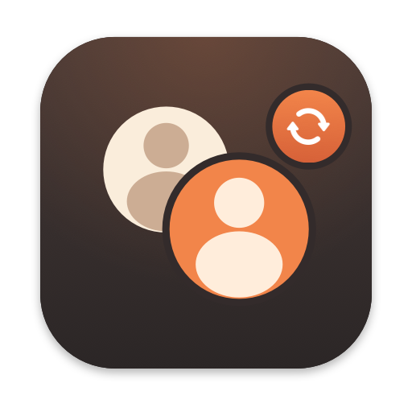
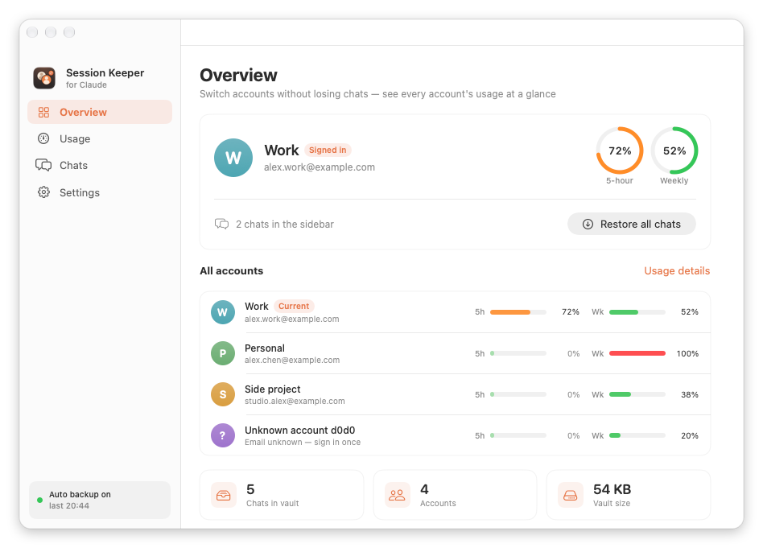
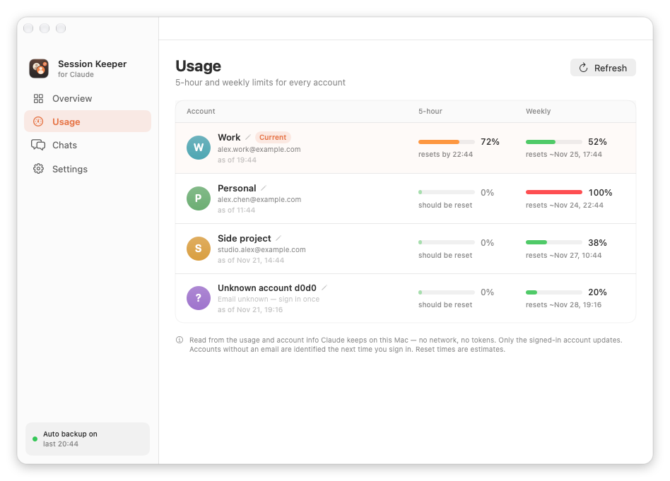

<p align="center">
  
</p>

<h1 align="center">Session Keeper for Claude</h1>

<p align="center">
  <b>Switch Claude accounts without losing your Claude Code chats.</b><br>
  A tiny macOS app that brings your Code-tab conversations along to every account.
</p>

<p align="center">
  <a href="../../releases/latest"></a>
  
  
  
  <a href="README.zh-CN.md"></a>
</p>

<p align="center"></p>

## The problem

You use more than one Claude account (work and personal, team and individual…). In the **Claude desktop app**, every time you sign in to a different account, the **Code tab sidebar is empty**: your Claude Code sessions, project chats and conversation history seem to be gone, and you have to set up your local projects again.

They aren't actually gone. The transcripts are still on disk. Claude just keeps **a separate sidebar list for each account**.

## What it does

- **One click after switching:** about a minute after you sign in to another account, a prompt asks *"You switched accounts. Restore now?"*. Click it and every previous chat shows up in the sidebar, ready to continue. Your projects are still there.
- **Usage for every account:** see each account's **email**, **5-hour** and **weekly** limit usage, and estimated reset times in one list, so you always know which account to switch to. You can also name accounts, like "Work" or "Personal". The numbers come from the usage the Claude app already records on your Mac; nothing is fetched online.
- **Automatic backup every minute:** your chat lists are always saved, even if you sign out without thinking about it. It writes only when something changed, so it uses a few MB.
- **Deleted stays deleted:** chats you delete in Claude are removed from every account and never come back.
- **Keep it tidy (optional):** "keep only the newest N chats from the last X days per project", applied on restore and by the **Clean up** button.
- **Moved your projects?** If you renamed or moved a project folder, it follows the new path.
- **Safe:** it works with local files only. It makes no network calls and never touches sign-in, tokens or account settings. Every restore and cleanup takes a snapshot first, and one click on **Undo** reverts it.

## Install

1. Download **`SessionKeeper-macOS.zip`** from [Releases](../../releases/latest), unzip it, and drag the app into **Applications**.
2. First launch: the app isn't notarized, so **right-click → Open → Open**. You can also go to *System Settings → Privacy & Security → Open Anyway*.
3. That's it. Automatic backup turns on by itself.

> Requires macOS 14+, the Claude desktop app, and Python 3. Python 3 ships with Apple's Command Line Tools; if it's missing, run `xcode-select --install`.

## How to use

| When | What to do |
|---|---|
| Every day | Nothing. Backup runs in the background. |
| After switching accounts | Open the **Code** tab once, then click **Restore now** when the prompt appears. Claude restarts in about 10 seconds. |
| Something looks wrong | Click **Undo**. |
| Too many old chats | Turn on *Keep only recent chats*, then click **Clean up**. |

## How it works

| What | Where | Shared across accounts? |
|---|---|---|
| Chat transcripts | `~/.claude/projects/<project>/<id>.jsonl` | ✅ yes |
| Sidebar list | `~/Library/Application Support/Claude/claude-code-sessions/<account>/<org>/local_*.json` | ❌ one per account |

Session Keeper copies the sidebar entries into a local vault (`~/.claude/session-vault/`). After an account switch, it writes them into the new account's list while Claude is closed. If an older transcript has no list entry at all, it rebuilds one from the transcript.

<details>
<summary>Command line</summary>

```bash
python3 claude_sessions.py status -v        # accounts, vault, orphaned transcripts
python3 claude_sessions.py backup           # save all accounts' chat lists
python3 claude_sessions.py sync --all       # backup + restore to every account (quit Claude first)
python3 claude_sessions.py sync --dry-run   # preview
python3 claude_sessions.py prune --dry-run  # preview cleanup by keep rules
python3 claude_sessions.py rollback         # undo last restore / cleanup
python3 claude_sessions.py install-agent    # background backup + switch detection (every 60 s)
python3 claude_sessions.py uninstall-agent
```

Settings live in `~/.claude/session-vault/config.json`:

```jsonc
{
  "path_remaps": { "/old/projects": "/new/projects" },   // moved project folders
  "skip_scheduled": true,                                  // ignore chats created by scheduled tasks
  "keep_rules": {
    "enabled": false, "max_age_days": 3, "max_per_project": 2,
    "always_keep": { "my-project": "Season \\d" }          // title regex that's always kept
  }
}
```
</details>

## Usage by account

<p align="center"></p>

The Claude app writes the signed-in account's plan usage to `~/Library/Application Support/Claude/plan-usage-history.json` (5-hour % and weekly %). Session Keeper reads that file, keeps a longer history in the vault, and shows every account side by side:

- **Only the signed-in account updates.** Other accounts show their state from the last time you used them. If that was more than 5 hours ago, the 5-hour limit is shown as reset (estimated).
- **Reset times are estimates.** The 5-hour reset comes from when continuous usage started. The weekly reset is 7 days after the first usage following a reset.
- **Emails** come from the account info Claude Code keeps in `~/.claude.json` (never the token). Each account's email is recorded the first time you sign in to it and stays on your Mac.
- **Refresh** re-reads the local file. To update another account, sign in to it and use Claude as usual.

It never calls Anthropic's servers, never reads tokens, and doesn't change or work around any limits. It only shows what the app already recorded.

## Build from source

```bash
git clone https://github.com/weinihu/claude-session-keeper.git
cd claude-session-keeper
./app/build.sh --install     # needs Xcode Command Line Tools (swiftc)
```

## FAQ

**Will this affect my Claude account?** No. It only reads and writes local files on your Mac. Nothing is sent anywhere.

**Does it work with the Claude Code CLI?** The CLI already shares `~/.claude` across logins. This tool is for the **desktop app's Code tab**, where the sidebar is per account.

**Can it break after a Claude update?** The sidebar format isn't documented, so it might. Snapshots and **Undo** keep you safe, and issues and PRs are welcome.

**Why does an account show old numbers?** Usage is only recorded while that account is signed in. Sign in and open the Code tab, then press **Refresh**.

**Windows / Linux?** Not yet. PRs welcome.

## Disclaimer

Not affiliated with or endorsed by Anthropic. "Claude" is a trademark of Anthropic, PBC. This project reads undocumented local files of the Claude desktop app. Use it at your own risk.

## License

[MIT](LICENSE)

---

<sub>Keywords: Claude multiple accounts · switch Claude account · Claude Code chat history lost · Claude Code sessions disappeared · restore Claude Code conversations · Claude desktop Code tab sidebar empty · Claude account switcher · backup Claude Code sessions · Claude 换号 · Claude 多账号 · 对话消失 · 历史对话恢复</sub>
